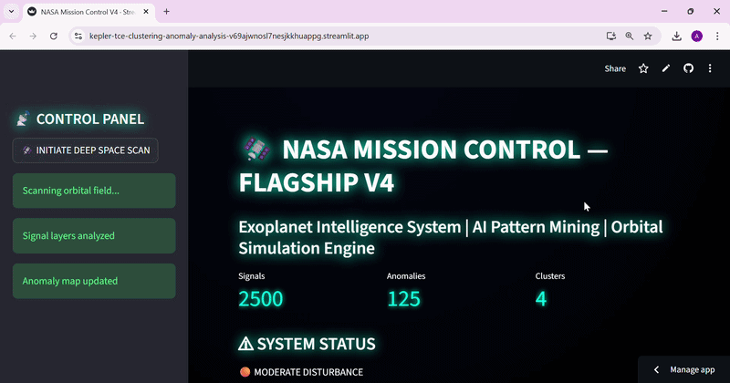
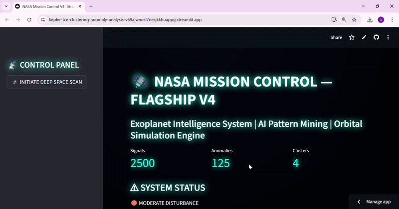

# Kepler TCE Clustering and Anomaly Analysis

##  What is this project about?

When a planet passes in front of its star, it can block a small amount of the star's light. This causes a small dip in the star's brightness, which astronomers can study to look for possible exoplanets.

NASA's Kepler mission collected observations of stars to help find planets beyond our Solar System. Its data-processing pipeline identified events that looked like possible planetary transits. These are called **Threshold-Crossing Events (TCEs)**.

A TCE is not necessarily a planet. It is a signal that needs further investigation because other astronomical objects, instrumental effects, or noise can also produce transit-like signals.

This project explores Kepler TCE data using unsupervised machine learning and statistical analysis. The goal is to find groups of signals with similar measured properties and identify signals that differ from the rest of the dataset.

The project also includes a Streamlit dashboard that demonstrates these ideas through interactive visualisations. The dashboard currently uses synthetic data, so its results are separate from the findings of the research notebook.

##  Project goals

The main goals are to:

- Explore the measured properties of Kepler TCEs.
- Group signals using K-Means clustering.
- Compare these groups with the density-based DBSCAN method.
- Use Isolation Forest to flag unusual signals.
- Use Principal Component Analysis (PCA) to visualise patterns in a lower-dimensional space.
- Compare transit depths between high-SNR and low-SNR groups.
- Present the analysis through notebook figures and an interactive dashboard prototype.

##  Dataset

The research notebook uses the **Kepler Q1–Q17 DR25 Threshold-Crossing Event table** from the NASA Exoplanet Archive.

- Raw dataset size: 34,032 rows and 113 columns.
- Four identifier and link columns are removed.
- Columns that are entirely missing are removed.
- The cleaned table contains 93 numerical columns.
- Four numerical features are used for the main machine-learning models.

### Features used

| Feature | Meaning |
|---|---|
| `tce_period` | Estimated orbital period, in days |
| `tce_depth` | Measured transit depth, in parts per million (ppm) |
| `tce_duration` | Estimated transit duration, in hours |
| `tce_model_snr` | Model signal-to-noise ratio |

These features describe different aspects of a transit-like signal. They are useful for exploring differences between events, but they are not enough on their own to determine whether a signal comes from a planet.

All four features are strongly right-skewed. The notebook standardises them with `StandardScaler` before applying the main models. Log-transformed versions of period, depth and SNR are also created for exploration, but the models use the standardised raw features.

##  Methods

### K-Means clustering

K-Means divides the signals into four groups using the four standardised features.

The notebook uses `n_clusters=4` and `random_state=42`. The resulting groups can be compared by their mean period, depth, duration and SNR.

The silhouette score is used to evaluate how well the assigned groups are separated.

### DBSCAN clustering

DBSCAN groups points based on the density of nearby observations. Unlike K-Means, it does not require a fixed number of clusters in advance and can label some observations as noise.

The notebook uses `eps=0.8` and `min_samples=10`.

### Isolation Forest

Isolation Forest identifies observations that are unusual compared with the overall feature distribution.

The notebook uses `contamination=0.05`, meaning the model is configured to flag approximately 5% of the observations as anomalies.

These flags indicate unusual measurements, not confirmed false positives, new planets or scientifically important discoveries.

### Principal Component Analysis (PCA)

PCA reduces the four standardised features to two principal components for visualisation.

This makes it easier to plot the observations and inspect possible groupings. The resulting axes are combinations of the original features, not direct measurements of orbital geometry.

### Random Forest

A Random Forest with 200 trees is trained to predict the K-Means cluster labels from the same four features.

Feature importance is examined to understand which features help the model reproduce the K-Means assignments.

This is a secondary analysis of the clustering results, not an independent model for confirming planets.

### Welch's t-test

Welch's t-test compares transit depths between two groups defined by splitting SNR at its median: a high-SNR group and a low-SNR group.

It tests whether the groups have evidence of different mean transit depths while allowing their variances to differ.

##  Main results

### K-Means

The notebook reports a silhouette score of approximately **0.562** for the four-cluster solution.

The cluster means show differences in the measured properties:

| Cluster | Mean period (days) | Mean depth (ppm) | Mean duration (hours) | Mean SNR |
|---|---:|---:|---:|---:|
| 0 | 397.9 | 2,077 | 13.9 | 13.8 |
| 1 | 9.4 | 182,399 | 5.8 | 10,761 |
| 2 | 31.7 | 3,227 | 5.7 | 86.7 |
| 3 | 36.3 | 308,357 | 6.2 | 1,217 |

Cluster 0 has the longest mean period. Clusters 1 and 3 have particularly large mean transit depths and SNR values.

These differences describe the groups found by the model. They do not establish that the groups correspond to particular planet sizes, planet types or confirmed astrophysical populations.

### DBSCAN

With the selected parameters, DBSCAN produces three distinct labels in the notebook's output, including any noise label.

This result depends on the chosen density settings and the standardised feature space. It should not be interpreted as proof that there are exactly three natural types of exoplanets.

### Isolation Forest

The notebook reports **1,702 flagged observations**, approximately 5% of the 34,032 records.

The flagged observations have substantially higher median transit depth and SNR than the observations not flagged:

| Feature | Flagged median | Not-flagged median |
|---|---:|---:|
| Transit depth (ppm) | 81,240 | 302 |
| SNR | 893 | 8.6 |
| Duration (hours) | 6.5 | 5.0 |
| Period (days) | 20.1 | 28.6 |

The flagged group also has higher mean depth and SNR. This suggests that the model is identifying observations with unusual feature values, especially in depth and SNR.

However, the number of anomalies is partly controlled by the selected contamination setting. A flagged observation is not automatically a false positive or a genuine discovery.

### Random Forest feature importance

| Feature | Importance |
|---|---:|
| `tce_period` | 0.74 |
| `tce_duration` | 0.12 |
| `tce_depth` | 0.10 |
| `tce_model_snr` | 0.03 |

Orbital period has the highest importance for predicting the K-Means labels in this analysis.

These values describe how the Random Forest reproduces the cluster assignments. They do not show that orbital period is the physical cause of the differences between the clusters.

### Statistical comparison

Welch's t-test gives a reported t-statistic of **2.60** and a p-value of approximately **0.00936**.

At the 0.05 significance level, this provides evidence of a difference in mean transit depth between the high-SNR and low-SNR groups.

The result does not establish causation, and statistical significance alone does not show that the difference is large or important for planet detection.

##  Interactive dashboard

**Live dashboard:** [Open the Streamlit app](https://kepler-tce-clustering-anomaly-analysis-v69ajwnosl7nesjkkhuappg.streamlit.app/)

**Dashboard code:** [`app.py`](app.py)

The dashboard is a separate visualisation prototype. It generates 2,500 synthetic observations using random distributions for period, depth, duration and SNR. It then standardises those features and applies K-Means, Isolation Forest and PCA.

The dashboard includes:

- Summary metrics for the number of generated signals, flagged anomalies and clusters.
- A PCA scatter plot coloured by K-Means cluster.
- An anomaly scatter plot showing Isolation Forest classifications.
- A 3D scatter plot using the first two principal components and transit depth.
- A mission-style interface with simulated telemetry messages, event messages and status panels.

The dashboard's scan button displays progress messages. The telemetry and mission-event messages are simulated, not live spacecraft data or actual astronomical discoveries.

**Important:** The dashboard does not currently load the NASA TCE table, reproduce the notebook's fitted models or display the notebook's numerical findings. Its metrics and plots should therefore be understood as demonstrations using synthetic data, not results from the real Kepler dataset.

### Dashboard demos





##  Limitations

This project is an exploratory analysis, and several limitations should be considered.

- **Limited features:** The main models use only four of the 93 numerical columns available after cleaning. Other useful measurements may contain information that is not captured here.
- **Skewed data:** All four features are strongly right-skewed. Standardisation puts features on comparable scales, but it does not remove skewness or make extreme values disappear.
- **Parameter choices:** The number of K-Means clusters, DBSCAN settings and Isolation Forest contamination value affect the results. A single set of settings cannot establish that the chosen solution is the best one.
- **No confirmed-label evaluation:** The notebook does not use planet-candidate and false-positive dispositions to test whether the clusters or anomaly flags correspond to known signal categories.
- **Anomalies are not discoveries:** Unusual measurements may come from genuine astrophysical signals, false positives, noise or data-processing effects.
- **Limited stability testing:** The results are not supported by a systematic comparison across different random seeds, parameter settings or alternative feature sets.
- **Random Forest interpretation:** The classifier predicts labels created by K-Means using the same features. Its feature importances explain the model's reproduction of those labels, not the physical causes of the observed patterns.
- **Statistical testing:** The t-test examines one selected comparison. It does not establish causation or demonstrate that the result generalises to every type of TCE.
- **Separate dashboard data:** The Streamlit application uses synthetic observations rather than the actual NASA dataset. It is not yet a dashboard for exploring the notebook's real results.

## Future work

There are several ways to improve this project.

1. **Connect the dashboard to the real dataset.** Load the Kepler TCE table and display the actual records, cluster assignments and anomaly flags from the analysis.
2. **Explore more features.** Test additional TCE measurements and compare the results with the current four-feature approach.
3. **Improve preprocessing.** Investigate log transformations, robust scaling and other methods for handling skewed measurements and extreme values.
4. **Test model stability.** Compare multiple parameter settings and random seeds to see whether the main patterns remain consistent.
5. **Validate against available labels.** Compare the model outputs with appropriate NASA disposition labels to investigate which signals are associated with known planet candidates and false positives.
6. **Compare additional methods.** Explore alternative clustering and anomaly-detection techniques and evaluate them with suitable measures.
7. **Improve the statistical analysis.** Report uncertainty, examine effect sizes and consider whether multiple-comparison corrections are needed for any expanded set of statistical tests.
8. **Explore suitable AI methods for transit detection.** After learning more about the underlying light-curve data, astrophysics and model evaluation, investigate whether supervised or deep-learning methods could help identify transit-like patterns. This would be a future extension, not a capability demonstrated by the current project.

##  How to run the notebook

1. Download the Kepler Q1–Q17 DR25 TCE table from the [NASA Exoplanet Archive](https://exoplanetarchive.ipac.caltech.edu/).
2. Download or clone this repository.
3. Install the Python dependencies:

   ```bash
   pip install -r requirements.txt
   ```

4. Set the correct path to the downloaded CSV in the notebook's data-loading cell.
5. Open `nasa_exoplanet_pattern_mining.ipynb` in Jupyter Notebook or Google Colab.
6. Run the cells in order.

The notebook uses Python, pandas, NumPy, SciPy, scikit-learn and Matplotlib.

## 10. How to run the dashboard

1. Clone the repository and open its folder.
2. Install the dependencies listed in `requirements.txt`.
3. Run:

   ```bash
   streamlit run app.py
   ```

4. Open the local URL provided by Streamlit.

The dashboard generates synthetic data internally, so it does not require the NASA CSV file to create its current visualisations.

##  Repository files

| File | Purpose |
|---|---|
| `nasa_exoplanet_pattern_mining.ipynb` | Research notebook and analysis of the Kepler TCE dataset |
| `app.py` | Streamlit dashboard prototype using synthetic data |
| `demo1.gif` | Dashboard demonstration |
| `demo2.gif` | Dashboard demonstration |
| `requirements.txt` | Python package dependencies |
| `Research-paper.pdf` | Project research paper |
| `LICENSE` | MIT licence |


##  Limitations

Although this project helped me explore patterns in Kepler TCE data, there are some limitations to consider:

- **Limited features:** The main models use only four numerical features, so other useful information in the dataset may be missed.
- **Parameter selection:** The results depend on choices such as the number of K-Means clusters and the settings used by DBSCAN and Isolation Forest.
- **No confirmed-label validation:** The clusters and anomaly flags have not been systematically evaluated against confirmed planet-candidate and false-positive labels.
- **Anomalies are not discoveries:** An unusual observation does not automatically indicate a new planet. It may have other astronomical or instrumental explanations.
- **Feature interpretation:** The Random Forest predicts labels generated by K-Means, so its feature importance values do not establish physical causes.
- **Dashboard uses synthetic data:** The Streamlit dashboard generates its own sample observations rather than loading the real Kepler dataset. Its visualisations demonstrate the methods but do not display the notebook's actual findings.
- **Further testing is needed:** The analysis would benefit from more systematic tests of model stability, alternative features and different parameter settings.

##  Future Work

I would like to develop this project further by:

1. **Connecting the dashboard to real Kepler data** so users can explore actual observations, clusters and anomaly flags.
2. **Testing additional features** to investigate whether more information improves the patterns identified by the models.
3. **Improving preprocessing** by exploring log transformations and alternative scaling methods for highly skewed data.
4. **Evaluating the models more carefully** by testing different parameters and random seeds.
5. **Comparing results with available NASA disposition labels** to investigate how the model outputs relate to known planet candidates and false positives.
6. **Exploring other machine-learning methods** to compare their strengths and limitations for astronomical data analysis.
7. **Learning more about computational astrophysics** and investigating suitable AI approaches for analysing transit signals and, eventually, supporting exoplanet detection.

These are planned improvements, not capabilities demonstrated by the current version of the project.

##  My Motivation

I chose to pursue Computer Science because I want to understand how computing and artificial intelligence can help us discover patterns, solve problems and explore questions about the universe. I have already started building my own small journey towards combining computer science with space science through projects like this one.

I see this project as a starting point rather than a finished achievement. With further study in computer science, machine learning and astrophysics, I hope to improve my existing work, explore more advanced methods and develop projects that bring these fields closer together. My long-term goal is to use what I learn to contribute to space research and make better use of the data we collect about the universe.

## Author

**Amna Fatima**

An aspiring computational astrophysicist interested in combining computer science, artificial intelligence and space science to explore astronomical data and uncover meaningful patterns.
##  Data acknowledgement

This project uses data from the NASA Exoplanet Archive, operated by the California Institute of Technology under contract with NASA through the Exoplanet Exploration Program.

The project is an independent educational analysis and is not affiliated with or endorsed by NASA.

## Author

**Amna Fatima**


---

